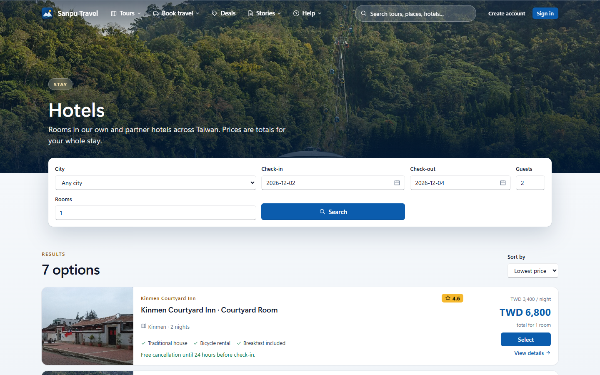

# Hotels, flights, buses & taxis search

App A · Sanpu Travel

| | |
|---|---|
| **Route** | `/hotels` |
| **Permission** |  |
| **Shown as** | anonymous visitor |
| **Area** | Customer |

## Purpose
Live availability and total prices from the database for each kind of travel, with filters, sorting, load more and detail pages.

## API (Swagger: `/swagger`, tag in the OpenAPI document)
- `GET /api/v1/travel/search?kind&from&to&date&endDate&units&travelers&sort`

## Stored procedures
- `usp_Services_Search`

## States
Loading skeleton while data loads · empty state ("Nothing here yet.") · error box with the server's message, a **Retry** button and the **correlation ID** · 403 page when the role lacks the permission (the API refuses the same call).

## Automated tests
- Covered by the screenshot run (`tests/e2e/screens.spec.ts`) and manual checklist; no dedicated functional test yet.

## Presenter script (30 seconds)
As an anonymous visitor, open **Hotels, flights, buses & taxis search**. and point out that everything on screen comes from SQL Server through `GET /api/v1/travel/search?kind&from&to&date&endDate&units&travelers&sort`. Mention the permission () is checked by the API, not only by hiding the menu, and that changes are written to the audit log.
