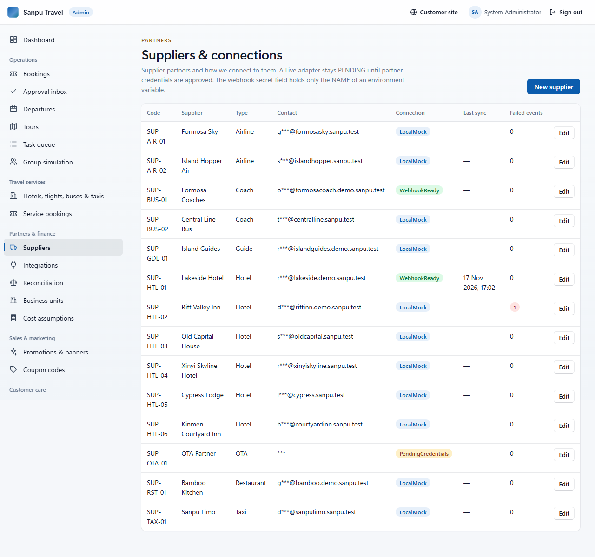

# Suppliers & connections

App A · Sanpu Travel

| | |
|---|---|
| **Route** | `/admin/suppliers` |
| **Permission** | Supplier.View / Supplier.Edit |
| **Shown as** | `admin@demo.sanpu.test` (fictional demo account) |
| **Area** | Admin |

## Purpose
PARTNERS

## Fields and validation
| Field | Type | Rules (client hint + server validation + SQL constraint) |
|---|---|---|
| Code | text | required · unique |
| Name | text | required · max 150 |
| Type | select | Hotel/Coach/Restaurant/Guide/OTA |
| Contact email | email | optional · masked in lists |
| Adapter | select | LocalMock / Webhook / (live: PENDING) |
| Webhook secret ref | text | name of env var only, never the secret |
| Rate limit / min | number | 1–600 |

## Actions
- **New supplier**
- **Save**

## API (Swagger: `/swagger`, tag in the OpenAPI document)
- `GET/POST/PUT /api/v1/ops/suppliers`

## Stored procedures
- `usp_Ops_Suppliers_List`
- `usp_Ops_Suppliers_Upsert`

## States
Loading skeleton while data loads · empty state ("Nothing here yet.") · error box with the server's message, a **Retry** button and the **correlation ID** · 403 page when the role lacks the permission (the API refuses the same call).

## Automated tests
- Covered by the screenshot run (`tests/e2e/screens.spec.ts`) and manual checklist; no dedicated functional test yet.

## Presenter script (30 seconds)
Signed in as admin, open **Suppliers & connections**. Click **New supplier** and point out that everything on screen comes from SQL Server through `GET/POST/PUT /api/v1/ops/suppliers`. Mention the permission (Supplier.View / Supplier.Edit) is checked by the API, not only by hiding the menu, and that changes are written to the audit log.
