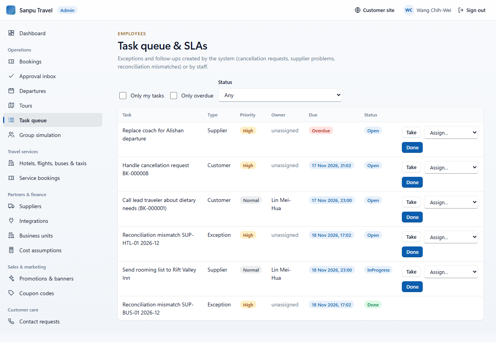

# Task queue & SLAs

App A · Tour Operations ERP

| | |
|---|---|
| **Route** | `/admin/tasks` |
| **Permission** | Task.View / Task.Work |
| **Shown as** | `ops.manager@demo.sanpu.test` (fictional demo account) |
| **Area** | Admin |

## Purpose
EMPLOYEES

## Fields and validation
| Field | Type | Rules (client hint + server validation + SQL constraint) |
|---|---|---|
| Assign to | select | active staff |
| Status | select | Open / In progress / Done |
| Note | textarea | max 1000 |

## Actions
- **Take**
- **Assign**
- **Complete**

## API (Swagger: `/swagger`, tag in the OpenAPI document)
- `GET /api/v1/ops/tasks?mine=`
- `POST /api/v1/ops/tasks/{id} {action: take|assign|start|done}`

## Stored procedures
- `usp_Tasks_List`
- `usp_Tasks_Update`

## States
Loading skeleton while data loads · empty state ("Nothing here yet.") · error box with the server's message, a **Retry** button and the **correlation ID** · 403 page when the role lacks the permission (the API refuses the same call).

## Automated tests
- Covered by the screenshot run (`tests/e2e/screens.spec.ts`) and manual checklist; no dedicated functional test yet.

## Presenter script (30 seconds)
Signed in as ops.manager, open **Task queue & SLAs**. Click **Take** and point out that everything on screen comes from SQL Server through `GET /api/v1/ops/tasks?mine=`. Mention the permission (Task.View / Task.Work) is checked by the API, not only by hiding the menu, and that changes are written to the audit log.
