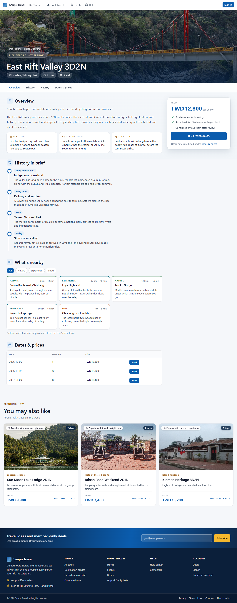

# Tour detail & departures

App A · Sanpu Travel

| | |
|---|---|
| **Route** | `/tours/TW-ERV-3D` |
| **Permission** | public |
| **Shown as** | anonymous visitor |
| **Area** | Customer |

## Purpose
TOUR

## Actions
- **Book this departure**

## API (Swagger: `/swagger`, tag in the OpenAPI document)
- `GET /api/v1/catalog/tours/{code}`

## Stored procedures
- `usp_Catalog_GetTour`
- `usp_Catalog_GetDeparture`

## States
Loading skeleton while data loads · empty state ("Nothing here yet.") · error box with the server's message, a **Retry** button and the **correlation ID** · 403 page when the role lacks the permission (the API refuses the same call).

## Automated tests
- `C01` customer books → ops approves → finance records payment → customer requests cancellation

## Presenter script (30 seconds)
As an anonymous visitor, open **Tour detail & departures**. Click **Book this departure** and point out that everything on screen comes from SQL Server through `GET /api/v1/catalog/tours/{code}`. Mention the permission (public) is checked by the API, not only by hiding the menu, and that changes are written to the audit log.
