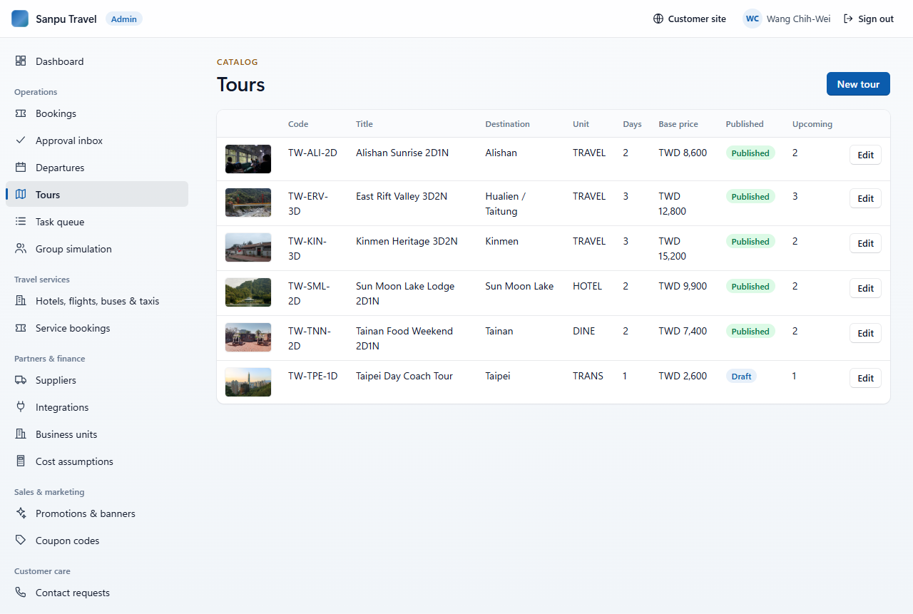

# Tours

App A · Sanpu Travel

| | |
|---|---|
| **Route** | `/admin/tours` |
| **Permission** | Catalog.Edit |
| **Shown as** | `ops.manager@demo.sanpu.test` (fictional demo account) |
| **Area** | Admin |

## Purpose
CATALOG

## Fields and validation
| Field | Type | Rules (client hint + server validation + SQL constraint) |
|---|---|---|
| Tour code | text | required · unique · ^[A-Z0-9-]+$ |
| Title | text | required · max 150 |
| Destination | select | Destinations table |
| Business unit | select |  |
| Days | number | 1–30 |
| Base price (TWD) | money | > 0 · max 2 decimals |
| Summary | textarea | max 2000 |
| Published | toggle | only published tours show to customers |

## Actions
- **New tour**
- **Save**

## API (Swagger: `/swagger`, tag in the OpenAPI document)
- `GET/POST/PUT /api/v1/ops/tours`

## Stored procedures
- `usp_Ops_Tours_List`
- `usp_Ops_Tours_Upsert`

## States
Loading skeleton while data loads · empty state ("Nothing here yet.") · error box with the server's message, a **Retry** button and the **correlation ID** · 403 page when the role lacks the permission (the API refuses the same call).

## Automated tests
- Covered by the screenshot run (`tests/e2e/screens.spec.ts`) and manual checklist; no dedicated functional test yet.

## Presenter script (30 seconds)
Signed in as ops.manager, open **Tours**. Click **New tour** and point out that everything on screen comes from SQL Server through `GET/POST/PUT /api/v1/ops/tours`. Mention the permission (Catalog.Edit) is checked by the API, not only by hiding the menu, and that changes are written to the audit log.
