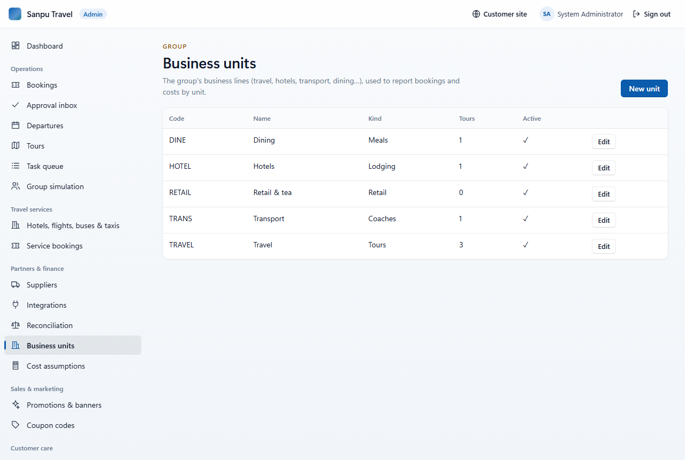

# Business units

App A · Tour Operations ERP

| | |
|---|---|
| **Route** | `/admin/business-units` |
| **Permission** | Catalog.Edit |
| **Shown as** | `admin@demo.sanpu.test` (fictional demo account) |
| **Area** | Admin |

## Purpose
Lets bookings, suppliers and costs be reported by group business unit

## Fields and validation
| Field | Type | Rules (client hint + server validation + SQL constraint) |
|---|---|---|
| Code | text | required · unique · A–Z |
| Name | text | required |
| Kind | select | Tours/Lodging/Coaches/Meals/Retail |

## Actions
- **Save**

## API (Swagger: `/swagger`, tag in the OpenAPI document)
- `GET/POST/PUT /api/v1/ops/business-units`

## Stored procedures
- `usp_Ops_BusinessUnits_List`
- `usp_Ops_BusinessUnits_Upsert`

## Rules, audit and security effects
- Lets bookings, suppliers and costs be reported by group business unit

## States
Loading skeleton while data loads · empty state ("Nothing here yet.") · error box with the server's message, a **Retry** button and the **correlation ID** · 403 page when the role lacks the permission (the API refuses the same call).

## Automated tests
- Covered by the screenshot run (`tests/e2e/screens.spec.ts`) and manual checklist; no dedicated functional test yet.

## Presenter script (30 seconds)
Signed in as admin, open **Business units**. Click **Save** and point out that everything on screen comes from SQL Server through `GET/POST/PUT /api/v1/ops/business-units`. Mention the permission (Catalog.Edit) is checked by the API, not only by hiding the menu, and that changes are written to the audit log.
