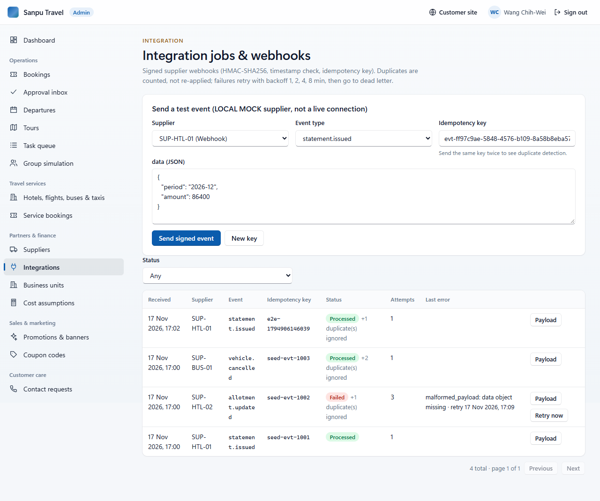

# Integration jobs & webhooks

App A · Sanpu Travel

| | |
|---|---|
| **Route** | `/admin/integrations` |
| **Permission** | Integration.View |
| **Shown as** | `ops.manager@demo.sanpu.test` (fictional demo account) |
| **Area** | Admin |

## Purpose
Correlation ID on each row; payloads redacted before storage

## Actions
- **Send signed event (LOCAL MOCK)**
- **Retry now**
- **View payload**

## API (Swagger: `/swagger`, tag in the OpenAPI document)
- `POST /api/v1/integrations/webhooks/{supplierCode} (HMAC-SHA256 signature, timestamp ±5 min, X-Idempotency-Key)`
- `GET /api/v1/ops/integrations/events`
- `POST /api/v1/ops/integrations/mock-send (LOCAL MOCK)`
- `POST /api/v1/ops/integrations/events/{id}/retry`

## Stored procedures
- `usp_Integration_IngestEvent (unique key → duplicate)`
- `usp_Integration_MarkResult (backoff 1,2,4,8,16 min)`

## Rules, audit and security effects
- Correlation ID on each row; payloads redacted before storage

## States
Loading skeleton while data loads · empty state ("Nothing here yet.") · error box with the server's message, a **Retry** button and the **correlation ID** · 403 page when the role lacks the permission (the API refuses the same call).

## Automated tests
- `D01` supplier webhook: signed mock event is processed once, duplicate is detected
- `D02` unsigned or badly signed webhooks are refused

## Presenter script (30 seconds)
Signed in as ops.manager, open **Integration jobs & webhooks**. Click **Send signed event (LOCAL MOCK)** and point out that everything on screen comes from SQL Server through `POST /api/v1/integrations/webhooks/{supplierCode}`. Mention the permission (Integration.View) is checked by the API, not only by hiding the menu, and that changes are written to the audit log.
