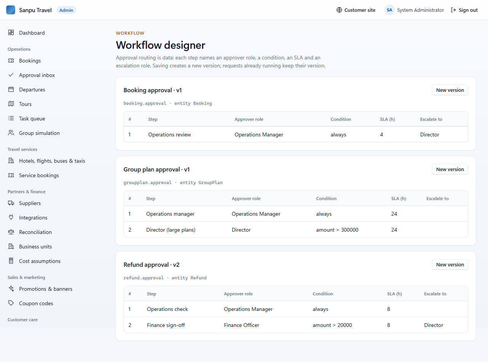

# Workflow designer

App A · Tour Operations ERP

| | |
|---|---|
| **Route** | `/admin/workflows` |
| **Permission** | Workflow.Edit |
| **Shown as** | `admin@demo.sanpu.test` (fictional demo account) |
| **Area** | Admin |

## Purpose
Routing comes only from these rows; nothing is hardcoded

## Fields and validation
| Field | Type | Rules (client hint + server validation + SQL constraint) |
|---|---|---|
| Workflow key | text | unique · locked |
| Entity type | select | Booking / Refund / GroupPlan / Proposal |
| Step · approver role | select | active role |
| Step · condition | select | always / amount > X / pax > X |
| SLA hours | number | 1–168 |
| Active | toggle | new instances use the latest active version |

## Actions
- **Add step**
- **Save new version**

## API (Swagger: `/swagger`, tag in the OpenAPI document)
- `GET/POST /api/v1/ops/workflows`

## Stored procedures
- `usp_Workflow_List`
- `usp_Workflow_SaveVersion`

## Rules, audit and security effects
- Routing comes only from these rows; nothing is hardcoded

## States
Loading skeleton while data loads · empty state ("Nothing here yet.") · error box with the server's message, a **Retry** button and the **correlation ID** · 403 page when the role lacks the permission (the API refuses the same call).

## Automated tests
- `D05` workflow designer validates and saves a new version

## Presenter script (30 seconds)
Signed in as admin, open **Workflow designer**. Click **Add step** and point out that everything on screen comes from SQL Server through `GET/POST /api/v1/ops/workflows`. Mention the permission (Workflow.Edit) is checked by the API, not only by hiding the menu, and that changes are written to the audit log.
